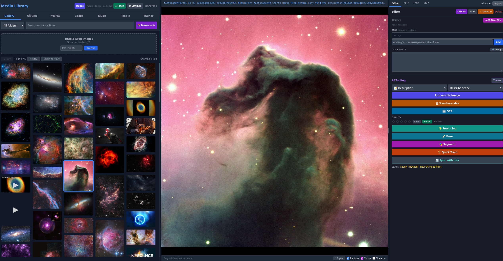
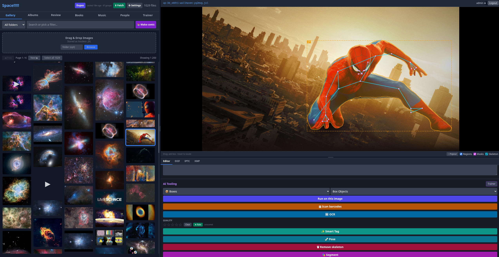
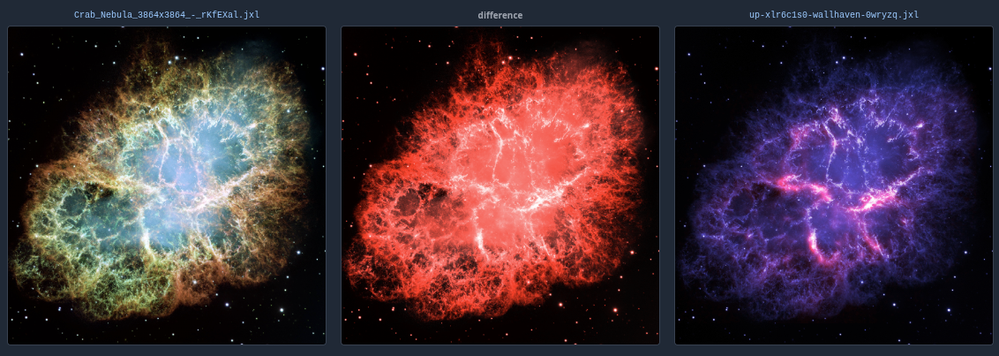
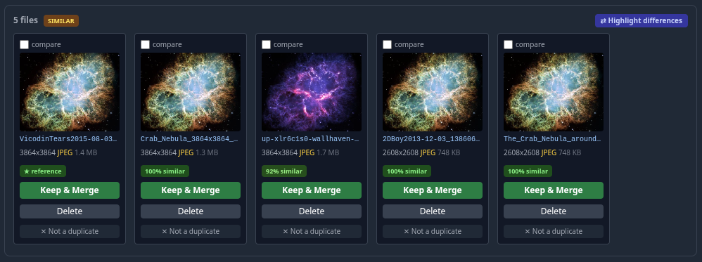

install:

```
git clone https://github.com/yggdrasil75/customimagemanager
cd customimagemanager
./install.sh
./run.sh
```

`install.sh` installs the system packages, builds the venv, installs the
python deps and fetches the vendored front-end JS. Modes are the docker ones:

```
./install.sh                 # detect GPU (cuda/rocm/cpu), full deps
./install.sh ultralight      # viewer + metadata only: no torch, no ML
./install.sh cuda            # force a backend: cpu | cuda | rocm
./install.sh cpu --minimal   # backend wheels only, nothing optional
./update.sh                  # git pull + reinstall that mode's deps
```

Modules are enabled and disabled in Settings -> Modules, and enabling one
installs its declared pip deps for you - that is the whole procedure, no
requirements file to hunt down. torch / torchvision / onnxruntime are the
exception: they come from `requirements-<backend>.txt` so they resolve against
the right wheel index, so a module needing them says so and waits for
`./install.sh cpu|cuda|rocm`. `CIM_NO_AUTO_INSTALL=1` turns the auto-install
off. So `--minimal` plus toggles is the "light" install, and a module whose
dep won't install just reports it and stays off.

Windows: use docker, or WSL.

alternatively:

```
docker compose up --build
```

with future runs just needing (outside of major updates):

```
docker compose up
```

what it is:

no image manager met my needs while being compatible with linux, no monthly fee, and fast.

so, make my own.

Major features:
All metadata that this projects creates is stored in the metadata sidecar (.xmp).
This includes faces, tags, descriptions, ratings, favorites, etc.
This does not include program specific data (embeddings).
This project reads most metadata formats, and more importantly: it shows the user the metadata.
most non-generated fields are editable (ie: you cant edit size or thumbnail, but you can edit EXIF:PageName)
(if you find something that isnt written to a file, and you think it should be, then please tell me)

You can load various different YOLO models, and run them on your entire library, or a single image.
You can generate boxes for your dog, your cat, your car, whatever else you might want using that.
This includes segmentation models, as well as SAM 2, SAM 3, FastSAM, MobileSam, and so on, allowing segmenting by object easily.
This also includes pose models (no generic keypoints yet. Just pose.) - which includes mediapipe as well.




Insightface is available for generating facial embeddings (find people in your photos)
This uses boxes from the YOLO face model to find people, and then cluster them.
A not exactly fully tested feature: "age eras" to try and resolve the same person from when they were a kid to an adult being clustered.
This also has a feature I need to better test: generating a face mesh from unconstrained photos (its kinda bad right now. it works, but not well)
and another to test: generating body shape from unconstrained photos. This needs a better dedicated model. The best option is not public.

I have also included various NR-IQA models (no reference image quality analysis).
These models typcially are built for finding only stuff like overcompressed images and not actually for the quality of the photo (when it gives you a 1* its not cause its bad, its cause its fuzzy.)

This also has a generic "VLM" mode where you can prompt with anything, and generate boxes, descriptions, tags, quality ratings, and so on.

I have build my own custom deduplication attempt that uses a heuristic model to try and improve upon how phashing (perceptual hash) and the naive "compare every pixel" approach to try and better find things like crops, rapid fire pictures, overly similar pictures (studio photos and the like) and so on. Most of the training was done on a variety of family photos, which while my sisters wedding photos definitely show the issues well, I dont want to provide here, so instead have a much worse showing of the results below. The eventual goal is the same idea on videos and audio since videos are exceedingly hard to find, and for audio I want to have the model able to pick out the same song, but all 38 different releases of it that Chicago put out on their albums without being unable to tell the difference between the same recording reencoded from flac to mp3 to ogg to wav, and back to flac.


